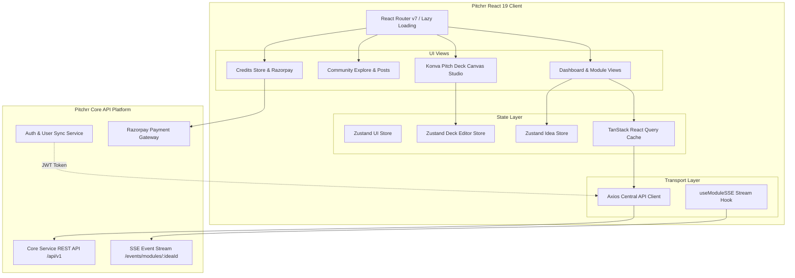
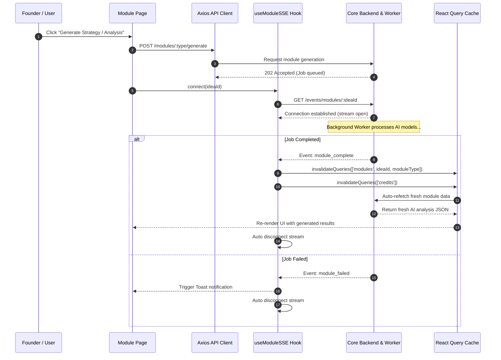
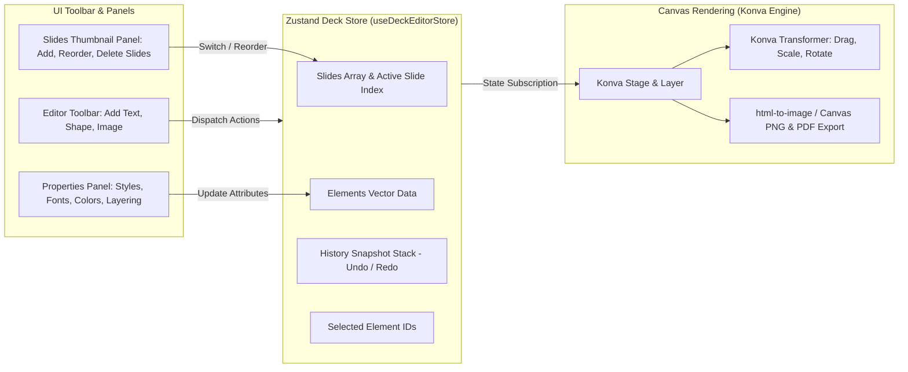
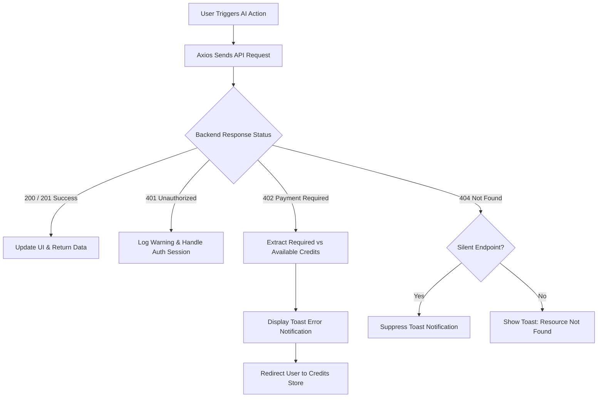

# Pitchrr - Client Application Documentation

Welcome to the frontend application repository for **Pitchrr**, an AI-powered co-builder platform designed to help founders, entrepreneurs, and builders turn raw business concepts into fully validated, market-ready startups.

---

## Table of Contents

- [Core Technology Stack](#core-technology-stack)
- [System Architecture & Flowcharts](#system-architecture--flowcharts)
  - [High-Level Client Architecture](#1-high-level-client-architecture)
  - [Real-Time SSE AI Generation Flow](#2-real-time-sse-ai-generation-flow)
  - [Pitch Deck Studio Engine Architecture](#3-pitch-deck-studio-engine-architecture)
  - [Credit Deduction & Interceptor Flow](#4-credit-deduction--interceptor-flow)
- [Core Functional Modules & Features](#core-functional-modules--features)
  - [Module 1: Idea Validation](#module-1-idea-validation)
  - [Module 2: Marketing Strategy](#module-2-marketing-strategy)
  - [Module 3: Branding Suite](#module-3-branding-suite)
  - [Module 4: Canva-Like Pitch Deck Studio](#module-4-canva-like-pitch-deck-studio)
  - [Module 5: Go-To-Market (GTM) Strategy](#module-5-go-to-market-gtm-strategy)
  - [Module 6: Competitor Analysis](#module-6-competitor-analysis)
  - [Module 7: Startup AI Advisor Chatbot](#module-7-startup-ai-advisor-chatbot)
  - [Module 8: Grants & Funding Matching](#module-8-grants--funding-matching)
  - [Community Explore & Social Profiles](#community-explore--social-profiles)
  - [Credits Store & Monetization](#credits-store--monetization)
  - [Global Feedback System](#global-feedback-system)
- [Directory Structure](#directory-structure)
- [Environment Configuration & Local Setup](#environment-configuration--local-setup)

---

## Core Technology Stack

| Category | Technology / Library | Purpose |
| :--- | :--- | :--- |
| **Core Framework** | **React 19** + **TypeScript** | Type-safe UI components, hooks, and modern concurrent rendering features. |
| **Build Tool** | **Vite 7** | Rapid development server, fast HMR, and optimized production bundle compilation. |
| **Styling & Icons** | **Tailwind CSS v4** + **Lucide React** | Utility-first design system paired with vector icon assets. |
| **Animations** | **Framer Motion** + **GSAP** + **Lenis** | Dynamic UI transitions, micro-interactions, layout morphing, and smooth scrolling. |
| **State Management** | **Zustand 5** | Light weight, reactive stores for Global UI state, Idea context, and Deck Canvas state. |
| **Server State & Caching** | **TanStack React Query v5** | Asynchronous data fetching, background refetching, and cache invalidation. |
| **Canvas Studio** | **Konva** + **React-Konva** | 2D canvas manipulation engine supporting multi-element drag, resize, rotate, and z-index ordering. |
| **Export Tools** | **html-to-image** + **html2canvas** | High-definition PNG rendering and slide deck export. |
| **HTTP Client & SSE** | **Axios** + **Fetch ReadableStream** | Centralized API client with request/response interceptors and real-time SSE streaming. |
| **Monetization** | **Razorpay Web Checkout** | Seamless credit package purchases and billing flow integration. |

---

## System Architecture & Flowcharts

### 1. High-Level Client Architecture

The Pitchrr client operates as a Single Page Application (SPA) driven by React Router v7. Route protection, state hydration, and centralized HTTP request pipelines coordinate communication with the core backend services.

---

### 2. Real-Time SSE AI Generation Flow

Instead of aggressive polling, module generation uses Server-Sent Events (SSE) via the custom `useModuleSSE` hook. When generation is triggered, an HTTP POST starts the background worker, and an SSE stream listens for completion events to invalidating specific query caches automatically.

---

### 3. Pitch Deck Studio Engine Architecture

The Pitch Deck Studio provides a Canva-like visual builder powered by Konva. All element mutations (text, shapes, images, layout changes) are captured in a single Zustand store with history tracking for full Undo/Redo capabilities.

---

### 4. Credit Deduction & Interceptor Flow

Pitchrr utilizes a credit system for AI module generation. The central Axios client intercepts response error codes to enforce soft handling of insufficient credits (HTTP `402 Payment Required`).

---

## Core Functional Modules & Features

Pitchrr includes 8 specialized co-builder modules along with social and monetization ecosystems:

### Module 1: Idea Validation
- **TAM/SAM/SOM Estimator**: Calculates Total Addressable Market, Serviceable Addressable Market, and Serviceable Obtainable Market.
- **Problem-Solution Fit**: Highlights core friction points and evaluates how effectively the proposed solution resolves target pain points.
- **Validation Scorecard**: Delivers an overall feasibility score breakdown across market readiness, technical feasibility, and financial viability.
- **Validation Roadmap**: Step-by-step experiment blueprint for testing key hypotheses.

### Module 2: Marketing Strategy
- **Channel Strategy**: Identifies optimal organic, paid, and community growth channels tailored to target demographics.
- **Marketing Campaign Generator**: Crafts launch campaigns, content pillars, and promotional angles.
- **Acquisition Funnel Mapping**: Outlines awareness, consideration, conversion, and retention touchpoints.

### Module 3: Branding Suite
- **Brand Identity Generator**: Suggests business names, taglines, brand stories, and tone-of-voice guidelines.
- **Interactive Color Palettes**: Displays curated color schemes complete with visual swatches and one-click hex copying.
- **Typography Pairings**: Recommends Google Font combinations tailored to brand personality.
- **Visual Card Exporter**: Generates shareable visual brand cards.

### Module 4: Canva-Like Pitch Deck Studio
- **Visual Drag & Drop Canvas**: Interactive Konva stage for layout editing.
- **Multi-Element Manipulation**: Manipulate text blocks, geometric shapes, icons, and image uploads with precise rotation, scaling, and z-index ordering.
- **Pre-Designed Layout Templates**: Slide presets for problem, solution, market size, business model, traction, and team.
- **Export Options**: Export pitch slides into high-resolution PNG image bundles or downloadable PDF documents.

### Module 5: Go-To-Market (GTM) Strategy
- **Phased Launch Timelines**: Pre-launch, private beta, public launch, and scaling roadmaps.
- **Sales & Distribution Channels**: Direct sales, inbound marketing, partnerships, and product-led growth (PLG) avenues.
- **Unit Economics Estimator**: Evaluates Customer Acquisition Cost (CAC) strategies and Lifetime Value (LTV) projections.

### Module 6: Competitor Analysis
- **Competitive Landscape Matrix**: Maps direct and indirect competitors against key feature vectors.
- **SWOT Analysis Breakdown**: Comprehensive Strengths, Weaknesses, Opportunities, and Threats evaluations.
- **Market Whitespace Identification**: Highlights underserved niches and key differentiators.

### Module 7: Startup AI Advisor Chatbot
- **Context-Aware Assistance**: Chatbot retains full context of the founder's active startup idea and generated modules.
- **Streaming AI Responses**: Real-time token streaming for fast, interactive responses.
- **Prompt Recommendations**: One-click prompt chips for pitch preparation, fundraising advice, and operational strategy.

### Module 8: Grants & Funding Matching
- **Grant Matchmaking Engine**: Matches startup profiles with available non-dilutive grants and institutional funding.
- **Eligibility Checker**: Assesses readiness criteria for government and private startup funds.
- **Investor Q&A Pitch Builder**: Prepares founders for tough investor questions during pitch meetings.

---

### Community Explore & Social Profiles
- **Public Pitch Feed**: Discover startup ideas posted by fellow founders (`Explore.tsx`).
- **Community Engagement**: Upvote, bookmark/save, and comment on public ideas.
- **User Profiles**: Custom creator profile pages displaying public posts, badges, and pitch history (`UserProfile.tsx`).
- **Post Management**: Dedicated dashboard for managing, editing, or deleting published ideas (`MyPosts.tsx`).

### Credits Store & Monetization
- **Credit Package Tiers**: Pay-as-you-go credit packages for running AI generation modules.
- **Razorpay Integration**: Seamless checkout modal flow.
- **Dynamic Balance Sync**: Real-time credit updates and transaction status logs (`CreditsStore.tsx`).

### Global Feedback System
- **Floating Feedback Widget**: Accessible feedback modal (`FeedbackWidget.tsx`) allowing users to report bugs or submit feature suggestions directly from any dashboard page.
